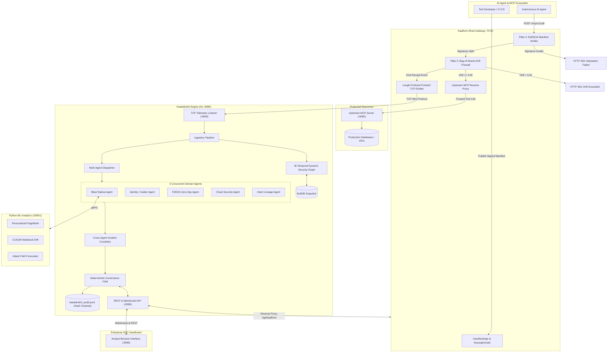
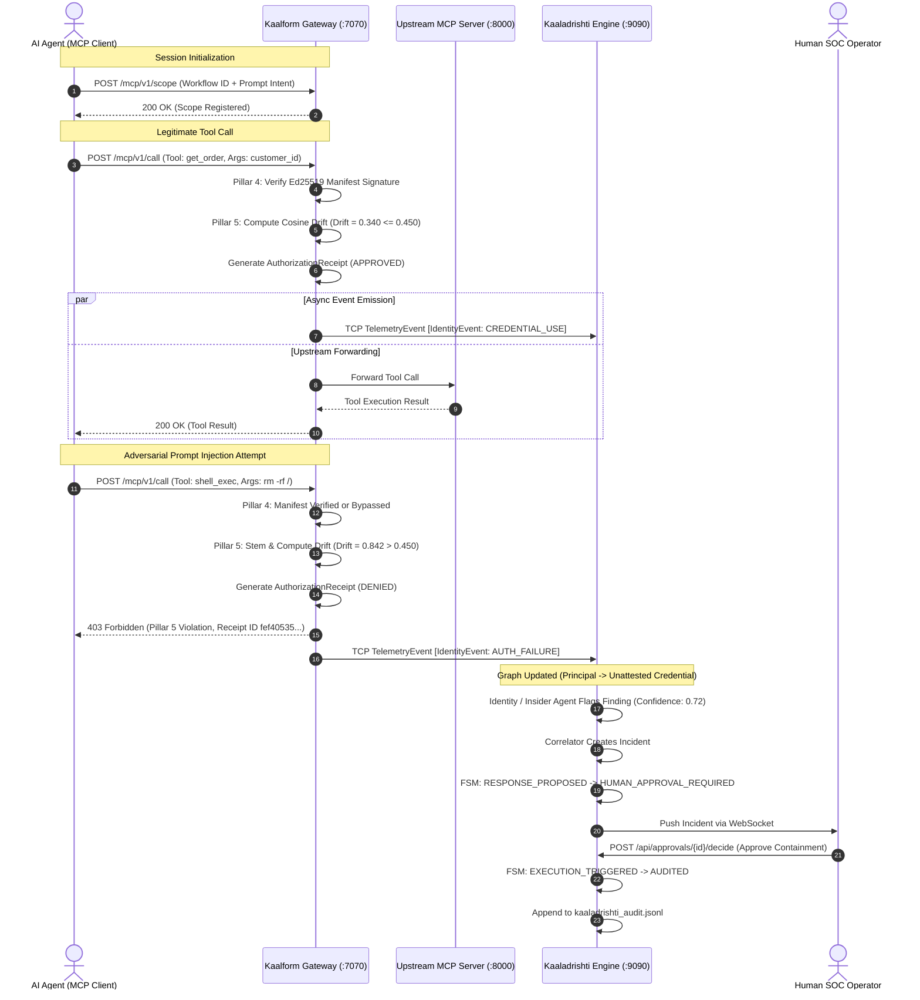
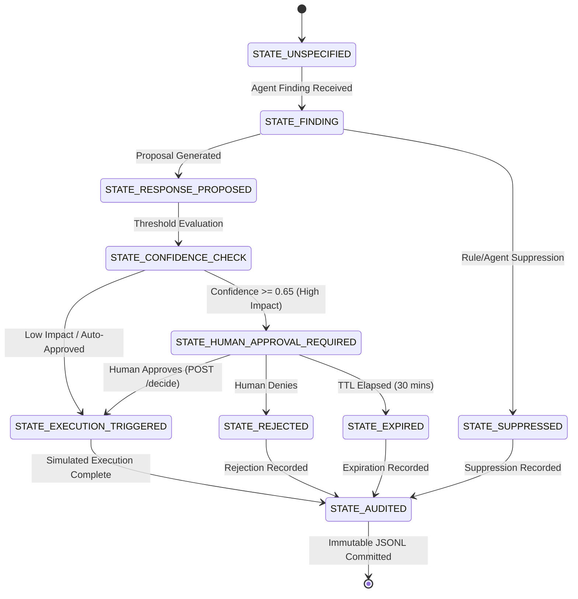

# KAALADRISHTI & KAALFORM: ENTERPRISE SYSTEM SPECIFICATION
## Comprehensive Architecture, Working Mechanisms, Software Requirements Specification (SRS), and Industry Differentiation

---

## 1. Executive Summary & Vision

### 1.1 The Modern Threat Paradigm (2026+)
Modern enterprise infrastructure faces two concurrent, intersecting threats:
1. **Multi-Stage Autonomous Cyber Attacks**: Adversaries pivot across hybrid clouds, containerized workloads, and identity providers in seconds, bypassing static SIEM rules and post-facto log correlation engines.
2. **Autonomous AI Agent Subversion & Tool Abuse**: As Large Language Models (LLMs) and Model Context Protocol (MCP) agents are granted operational privileges (database access, API tokens, shell execution, code deployments), prompt injection, jailbreaks, and goal hijacking allow attackers to convert trusted AI agents into confused deputies.

### 1.2 The Unified Solution: Kaaladrishti + Kaalform
**Kaaladrishti** (Sanskrit for *"Vision of Time"*) and **Kaalform** provide an end-to-end, real-time, mathematically grounded cyber defense and AI agent firewall mesh:
- **Kaaladrishti**: The central defense engine. It maintains a **Bi-Temporal Dynamic Security Graph**, conducts predictive zero-day attack path forecasting (Personalized PageRank and CUSUM drift detection), coordinates **5 concurrent domain analysis agents**, and enforces a **Deterministic Governance Finite State Machine (FSM)** with human-in-the-loop authorization and append-only audit logging.
- **Kaalform**: The high-performance **Agent Execution Firewall**. Operating as an MCP reverse proxy in Rust, it enforces **Pillar 4 (Cryptographic Tool-Manifest Attestation)** using Ed25519 digital signatures and **Pillar 5 (Context-to-Action Provenance Guardrails)** using Bag-of-Words cosine drift scoring with morphological stemming. It emits length-prefixed Protobuf events into Kaaladrishti over TCP, closing the loop between AI agent action and enterprise SOC containment.

---

## 2. The Five Pillars of Cyber Defense

```
+----------------------------------------------------------------------------------------------------+
|                                    KAALADRISHTI DEFENSE MESH                                       |
+-------------------------------------------------+--------------------------------------------------+
|                     KAALADRISHTI                |                     KAALFORM                     |
|                   (Central Engine)              |             (Agent Execution Firewall)           |
+-------------------------------------------------+--------------------------------------------------+
|  Pillar 1: PZEDS & Predictive Zero-Day Engine   |  Pillar 4: Cryptographic Tool Attestation        |
|  Pillar 2: Dynamic Identity & Temporal Graph    |  Pillar 5: Provenance Firewall & Receipts        |
|  Pillar 3: Multi-Agent Orchestration & FSM Gov  |                                                  |
+-------------------------------------------------+--------------------------------------------------+
```

### Pillar 1: Predictive Zero-Day Exploitation Detection System (PZEDS) & Blast Radius Forecaster
* **Subsystem**: Python ML Analytics Service (`services/ml-analytics/`, port `50051`) & PZEDS FastAPI Backend (`zero_day_exploit/`, port `8000`).
* **Mechanism**:
  - **Personalized PageRank (PPR)**: Calculates dynamic blast radius over directional graph subgraphs. When an asset is compromised, PPR calculates probability distributions of attacker propagation across nodes within milliseconds.
  - **CUSUM (Cumulative Sum) Statistical Drift Detection**: Tracks behavioral metrics (API call volume, token dispersion, network jitter) against historical baselines, isolating zero-day anomalies before known signatures exist.
  - **Next-Attack Forecaster**: Generates multi-hop attack vectors and likelihood rankings, feeding proactive honeypot and credential rotation proposals to the governance orchestrator.

### Pillar 2: Dynamic Identity & Temporal Security Graph
* **Subsystem**: Go Engine Graph Layer (`internal/graph/`).
* **Mechanism**:
  - **In-Memory Bi-Temporal Graph**: Thread-safe bidirectional adjacency list maintaining nodes (`Principal`, `Credential`, `Tool`, `Resource`, `Host`, `Process`, `Vulnerability`) and edges (`ASSUMES_ROLE`, `USES_CREDENTIAL`, `CALLS_TOOL`, `ACCESSES`, `EXECUTES`).
  - **Edge Recency Decay**: Time-decay function:
    $$\text{Weight}(t) = W_0 \cdot e^{-\lambda(t_{\text{current}} - t_{\text{edge}})}$$
    Prevents stale lateral paths from distorting active attack graphs while preserving audit lineage.
  - **BoltDB Transactional Snapshotting**: Key-value snapshot persistence (`kaaladrishti_graph.db`) providing zero-data-loss warm restarts in $< 50\text{ ms}$.

### Pillar 3: Multi-Agent Orchestration & Deterministic Governance FSM
* **Subsystem**: Go Engine Agent & Governance Layer (`internal/agents/`, `internal/governance/`, `internal/orchestration/`).
* **Mechanism**:
  - **Concurrent Domain Agents**: 5 parallel analysis agents evaluate every telemetry ingest:
    1. *Blast Radius & Next-Attack Prediction Agent* (interfaces with Python ML via gRPC)
    2. *Identity / Insider Threat Agent* (detects lateral movement, privilege elevation, unattested credential usage)
    3. *Predictive Zero-Day Exploitation Agent (PZEDS)* (detects unknown memory/API anomalies)
    4. *Cloud Security & Misconfiguration Agent* (flags IAM drift, VPC policy violations)
    5. *Intent Lineage & Drift Detection Agent* (monitors session sequence deviations)
  - **Cross-Agent Correlator**: Groups discrete findings into unified `Incident` contexts over sliding temporal windows.
  - **Deterministic 6-State FSM**:
    $$\text{FINDING} \longrightarrow \text{RESPONSE\_PROPOSED} \longrightarrow \text{CONFIDENCE\_CHECK} \longrightarrow \text{HUMAN\_APPROVAL\_REQUIRED} \longrightarrow \text{EXECUTION\_TRIGGERED} \longrightarrow \text{AUDITED}$$
  - **Confidence Gate**: Automated containment proposals with confidence $\ge 0.65$ generate an `AuthorizationRequest` requiring operator approval. Lower confidence proposals require manual SOC escalation.
  - **Tamper-Evident Audit Trail**: Every state transition writes an append-only JSONL record with SHA-256 hash chaining to `kaaladrishti_audit.jsonl`.

### Pillar 4: Cryptographic Tool-Manifest Attestation & Ed25519 Signing
* **Subsystem**: Kaalform Rust Gateway (`crates/kaalform/src/manifest.rs`, `src/verifier.rs`).
* **Mechanism**:
  - **Tool Manifest (`ToolManifest`)**: Cryptographic document declaring tool identity, version, allowed principals, capability scopes, and expiration timestamp.
  - **Canonical JSON Serialization (RFC 8785)**: Deterministic key ordering and whitespace elimination before hashing, ensuring invariant byte digests.
  - **Ed25519 Digital Signatures**: Tool developers or CI/CD signing pipelines sign the SHA-256 digest with an Ed25519 private key.
  - **Trust Store Fingerprint Verification**: Kaalform validates the signature against an in-memory or persisted trust store (`crates/kaalform/config/trusted_keys.json`) using SHA-256 public key fingerprints before allowing any tool invocation.
  - **Tamper Resistance**: Any alteration of capabilities, parameters, or permissions invalidates the signature, yielding an immediate cryptographic block.

### Pillar 5: Context-to-Action Provenance Firewall & Authorization Receipts
* **Subsystem**: Kaalform Rust Gateway (`crates/kaalform/src/provenance.rs`, `src/emitter.rs`).
* **Mechanism**:
  - **Session Scope Baseline**: Orchestrators declare prompt scope upon workflow creation (`POST /mcp/v1/scope` or via manifest auto-scope).
  - **Bag-of-Words Cosine Drift Engine**: When an agent attempts an MCP tool call (`POST /mcp/v1/call`), Kaalform extracts and stems action tokens (`-ies`, `-ing`, `-ed`, `-s`), strips JSON structural noise (`action`, `arguments`, `params`), and computes cosine distance against the declared scope baseline:
    $$\text{Drift} = 1.0 - \frac{\vec{V}_{\text{action}} \cdot \vec{V}_{\text{scope}}}{\|\vec{V}_{\text{action}}\| \|\vec{V}_{\text{scope}}\|}$$
  - **Drift Gate Threshold**: If $\text{Drift} > \text{Threshold}$ (default $0.45$), the call is aborted immediately with HTTP `403 Forbidden`. Prompt injections attempting commands like `shell_exec rm -rf` or credential exfiltration exhibit drift $\approx 0.85$–$0.95$ and are blocked deterministically.
  - **Immutable Authorization Receipts**: Every gate evaluation generates a cryptographically indexed UUIDv4 `AuthorizationReceipt` containing verdict, drift score, threshold, and offending tokens.
  - **Real-Time Cross-Mesh Emission**: Receipts are serialized into 4-byte length-prefixed Protobuf `TelemetryEvent` frames carrying `IdentityEvent` payloads and transmitted via TCP to Kaaladrishti (`127.0.0.1:9090`), triggering real-time SOC alerts and graph updates.

---

## 3. Technology Stack & Tools Architecture

| Layer / Component | Technology | Version | Purpose & Rationale |
| :--- | :--- | :--- | :--- |
| **Kaalform MCP Gateway** | **Rust** | Edition 2021 | Zero-overhead, memory-safe, sub-millisecond reverse proxy. |
| HTTP Web Framework | `axum` | 0.8.x | High-throughput asynchronous routing and middleware. |
| Asynchronous Runtime | `tokio` | 1.x | Multi-threaded async I/O, timers, and TCP socket management. |
| Asymmetric Cryptography | `ed25519-dalek` | 2.1.x | Ultra-fast Ed25519 signature generation and verification. |
| Hashing & Digests | `sha2` | 0.10.x | Cryptographic SHA-256 for canonical manifest digests. |
| Wire Serialization | `prost` + `prost-build` | 0.13.x | Zero-allocation Protocol Buffers encoding for Rust $\rightarrow$ Go telemetry. |
| Upstream Proxy Client | `reqwest` | 0.12.x | High-performance HTTP client for proxied MCP invocations. |
| Logging & Observability | `tracing` + `tracing-subscriber` | 0.1.x | Structured JSON diagnostics with millisecond precision. |
| **Kaaladrishti Core Engine** | **Go** | 1.24.x | Fast, concurrent, low-latency orchestration and graph engine. |
| HTTP Router | `chi` | v5.2.x | Lightweight, idiomatic HTTP router with zero external dependencies. |
| Structured Logging | `zerolog` | 1.33.x | Zero-allocation JSON logging for enterprise SOC ingestion. |
| Protocol Buffers | `google.golang.org/protobuf`| v1.36.x | Strict schema compliance across Rust, Go, and Python. |
| Real-time WebSockets | `gorilla/websocket` | v1.5.x | Bi-directional streaming of SOC graph events and alerts. |
| Embedded Snapshot DB | `bbolt` (BoltDB) | v1.4.x | ACID transactional, single-file embedded B+ tree persistence. |
| Reverse Proxy | `net/http/httputil` | Standard | Native Go reverse proxy mounting Kaalform under `/api/kaalform/*`. |
| **Machine Learning Service**| **Python** | 3.13.x | High-level scientific and graph analytics runtime. |
| RPC Service | `grpcio` + `grpcio-tools` | 1.70.x | High-performance binary RPC protocol serving the Go engine. |
| Graph Analytics | `networkx` | 3.4.x | Fast graph operations, PageRank, and path discovery. |
| Scientific Computing | `numpy` + `scikit-learn` | 2.2.x / 1.6.x | Vector operations, similarity calculations, statistical CUSUM. |
| Web Backend (PZEDS) | `fastapi` + `uvicorn` | 0.115.x | Zero-day behavioral backend and simulated MCP target. |
| **SOC Operator UI** | **Vanilla Web (HTML5/CSS3/JS)** | Native | Zero-dependency, lightweight, high-performance dark-mode SOC dashboard. |
| Visualization | Custom SVG Graph Engine | Native | Real-time interactive node-link rendering with drag/zoom. |

---

## 4. System Workflow Diagrams

### 4.1 Global High-Level Architecture



---

### 4.2 Kaalform Interception & Provenance Sequence



---

### 4.3 Governance FSM State Machine



---

## 5. Software Requirements Specification (SRS)

### 5.1 Functional Requirements

#### Pillar 1: Predictive Zero-Day Exploitation Detection System (PZEDS)
* **FR-1.1**: The system shall compute graph Personalized PageRank (PPR) over target nodes with teleport probability $\alpha = 0.85$ within $100\text{ ms}$.
* **FR-1.2**: The ML service shall calculate sequential CUSUM drift on incoming session token streams, flagging anomalies exceeding $h = 5.0$ decision intervals.
* **FR-1.3**: The service shall expose gRPC endpoints `CalculateBlastRadius`, `ForecastNextAttacks`, and `DetectCUSUMDrift` adhering to `platform.proto`.

#### Pillar 2: Dynamic Identity & Temporal Security Graph
* **FR-2.1**: The Go engine graph store shall support concurrent atomic insertions of nodes and directional edges.
* **FR-2.2**: The graph store shall support bi-temporal queries: `AsOf(valid_time, transaction_time)`.
* **FR-2.3**: Stored edge weights shall undergo exponential time decay at configured intervals (default: $60\text{ s}$, decay factor $0.95$).
* **FR-2.4**: Graph state shall serialize into BoltDB (`kaaladrishti_graph.db`) every $60\text{ s}$ and restore completely upon restart.

#### Pillar 3: Multi-Agent Orchestration & Deterministic Governance FSM
* **FR-3.1**: The dispatcher shall fan out each incoming `TelemetryEvent` to all 5 domain agents concurrently using Go goroutines with a $10\text{ s}$ deadline.
* **FR-3.2**: Agent findings shall include severity, confidence score ($[0.0, 1.0]$), subject node ID, and evidence graph references.
* **FR-3.3**: The Correlator shall cluster findings with overlapping graph nodes occurring within a $5\text{ minute}$ window into a single `Incident`.
* **FR-3.4**: When proposal confidence $\ge 0.65$, the FSM shall transition to `HUMAN_APPROVAL_REQUIRED` and block execution until operator decision.
* **FR-3.5**: Every FSM state change shall append an entry to `kaaladrishti_audit.jsonl` with an incremental hash chain.

#### Pillar 4: Cryptographic Tool-Manifest Attestation
* **FR-4.1**: Kaalform shall validate `ToolManifest` canonical JSON representation according to RFC 8785.
* **FR-4.2**: Kaalform shall verify Ed25519 digital signatures using public keys stored in `trusted_keys.json` indexed by SHA-256 fingerprint.
* **FR-4.3**: Manifests with expired `valid_until` timestamps or altered payloads shall be rejected with HTTP `400/403`.
* **FR-4.4**: Kaalform shall provide `/keys/generate`, `/manifest/sign`, and `/manifest/verify` endpoints for operational key management.

#### Pillar 5: Context-to-Action Provenance Firewall
* **FR-5.1**: Kaalform shall register declared session scopes via `POST /mcp/v1/scope` or extract them automatically from tool manifests.
* **FR-5.2**: The provenance engine shall tokenize actions into lowercase alphabetic strings, apply English suffix stemming (`-ies`, `-ing`, `-ed`, `-s`), and filter standard stop words and JSON wrapper keywords.
* **FR-5.3**: Kaalform shall compute cosine drift against declared scope and deny actions with drift exceeding `KAALFORM_DRIFT_THRESHOLD` (default: $0.45$).
* **FR-5.4**: Kaalform shall issue an immutable `AuthorizationReceipt` with UUIDv4, verdict, score, and drift tokens for every call.
* **FR-5.5**: Kaalform shall emit length-prefixed Protobuf `TelemetryEvent` frames to Kaaladrishti over TCP without blocking the HTTP proxy response.

---

### 5.2 Non-Functional Requirements (NFR)

* **NFR-1 (Latency)**: Kaalform gateway interception overhead shall not exceed $5\text{ ms}$ per call (excluding upstream execution time).
* **NFR-2 (Throughput)**: Kaalform shall handle $\ge 5,000\text{ req/sec}$ per node under multi-threaded Tokio async runtime.
* **NFR-3 (Memory Safety)**: All gateway and cryptographic enforcement code shall be compiled in Rust with zero `unsafe` blocks.
* **NFR-4 (Failure Isolation)**: Ingestion or telemetry socket failure between Kaalform and Kaaladrishti shall never crash either process; communication operates best-effort with non-blocking error logging.
* **NFR-5 (Cryptographic Rigor)**: Signature schemes must be Ed25519 (Curve25519 EdDSA); hashes must be SHA-256. No deprecated primitives (MD5, SHA-1, RSA-1024) are permitted.
* **NFR-6 (Audit Tamper Evidence)**: Audit log entries must be strictly append-only. Deleting or modifying a historical line must break hash verification.
* **NFR-7 (Platform Portability)**: Kaaladrishti and Kaalform must execute natively on Windows (x86_64), Linux (amd64/arm64), and within Docker / Docker Compose containers.
* **NFR-8 (Operator Usability)**: The SOC dashboard shall load in $< 500\text{ ms}$, provide real-time updates via WebSockets without page reload, and function without external CDN or internet dependencies.

---

### 5.3 Data Schemas & Wire Contracts

#### 5.3.1 Kaalform Tool Manifest Schema (`manifest.rs`)
```json
{
  "body": {
    "manifest_version": "1.0",
    "tool_id": "kaaladrishti/graph-query@1.0.0",
    "tool_name": "Graph Query Utility",
    "tool_version": "1.0.0",
    "developer_id": "core-platform-team",
    "allowed_principals": ["agent-analyst", "agent-customer-support"],
    "capabilities": ["graph:read", "telemetry:query"],
    "valid_until": "2027-01-01T00:00:00Z",
    "signing_key_fingerprint": "7b26ebc5712e391e1401a986cfa26148639e3c9bf06546d02ad84724978b949a"
  },
  "signature": "3f98a2...64_bytes_hex_encoded_ed25519_signature..."
}
```

#### 5.3.2 Kaalform Authorization Receipt Schema (`provenance.rs`)
```json
{
  "receipt_id": "9beb3470-0c7c-4ab4-94aa-4773bbfc4680",
  "workflow_id": "wf-customer-ops-6836",
  "tool_id": "get_order",
  "principal_id": "agent-customer-support",
  "verdict": "APPROVED",
  "drift_score": 0.340,
  "drift_threshold": 0.450,
  "reason": "action aligned with declared workflow scope",
  "issued_at_ms": 1791841380530,
  "drift_tokens": []
}
```

#### 5.3.3 Protocol Buffers Ingestion Wire Contract (`platform.proto`)
```protobuf
syntax = "proto3";
package kaaladrishti.v1;

message TelemetryEvent {
  string event_id = 1;
  int64 timestamp_ms = 2;
  string source_id = 3;
  oneof payload {
    NetworkEvent network = 4;
    ProcessEvent process = 5;
    FileEvent file = 6;
    IdentityEvent identity = 7;
    CloudEvent cloud = 8;
  }
}

message IdentityEvent {
  string principal_id = 1;
  string target_credential_id = 2;
  IdentityEventType event_type = 3; // CREDENTIAL_USE, AUTH_FAILURE, ROLE_ASSUME
  string source_ip = 4;
  map<string, string> metadata = 5;
}
```

---

## 6. Comprehensive Industry Differentiation

How does **Kaaladrishti + Kaalform** compare to existing cybersecurity solutions?

### 6.1 Competitive Analysis Matrix

| Feature / Dimension | Traditional SIEM / SOAR (Splunk, Sentinel) | Cloud Security / CSPM (Wiz, Prisma) | LLM Guardrails (NeMo, Llama Guard) | Identity Threat / ITDR (CrowdStrike, Silverfort) | **Kaaladrishti + Kaalform** |
| :--- | :--- | :--- | :--- | :--- | :--- |
| **Primary Domain** | Log aggregation, post-incident query. | Static cloud infrastructure misconfigurations. | Prompt text filtering & moderation. | Active Directory & SSO session anomaly detection. | **Unified Temporal Graph + AI Agent Execution Firewall.** |
| **AI Agent Tool Protection** | ❌ None (treats agents as generic API users). | ❌ None (infrastructure only). | ⚠️ Text heuristics only (no cryptographic signing). | ⚠️ Limited to OAuth/SSO credentials. | ✅ **Cryptographic Ed25519 Tool Attestation + Cosine Drift Gate.** |
| **Zero-Day Prediction** | ❌ Reactive (requires known signature/rule). | ⚠️ Periodic scan vulnerability graph. | ❌ None. | ⚠️ Rule-based lateral anomaly. | ✅ **PZEDS CUSUM Drift + Personalized PageRank Forecaster.** |
| **Data Representation** | Disjoint flat tabular log records. | Static topological resource tree. | Single-turn token buffers. | Identity-only auth logs. | ✅ **Bi-Temporal Graph with exponential recency decay.** |
| **Response Governance** | Scripted playbooks (often brittle or opaque). | JIRA / Ticket alerts; manual remediation. | String replacement or generation abort. | Inline conditional access block. | ✅ **Deterministic 6-State FSM with Confidence Gating.** |
| **Audit Integrity** | Vendor proprietary log store. | Audit trail in cloud logs. | Ephemeral chat logs. | Domain controller audit events. | ✅ **SHA-256 Hash-Chained Append-Only JSONL.** |
| **Interception Latency** | Seconds to minutes (ingest pipeline lag). | Hours (periodic asynchronous scans). | $100\text{ ms}$–$500\text{ ms}$ (LLM evaluation overhead). | $20\text{ ms}$–$50\text{ ms}$ (auth proxy). | ✅ **$< 5\text{ ms}$ (Compiled Rust Bag-of-Words Cosine Engine).** |
| **Air-Gap / Self-Hosted** | ⚠️ Complex on-prem cluster setup. | ❌ Cloud-only SaaS architecture. | ⚠️ Requires high-end GPU for guardrail models. | ⚠️ Windows server agents required. | ✅ **Single-binary Rust & Go (zero GPU or cloud requirements).** |

---

### 6.2 The Unfair Technical Advantages of Kaaladrishti + Kaalform

1. **Closing the "Agent Execution Blind Spot"**:
   Existing LLM security guardrails inspect *natural language prompts* before reaching the model. However, if prompt injection occurs via indirect data (RAG poisoning, database rows, email bodies), traditional guardrails fail. Kaalform sits **between the model and the real world** at the tool execution boundary (MCP). Regardless of what the LLM hallucinates or is coerced into believing, it cannot execute an unattested tool or deviate from declared session intent.
2. **Deterministic Governance vs. Hallucinatory Autonomous Agents**:
   Autonomous "AI SOC Analysts" that auto-remediate infrastructure often introduce catastrophic operational risks by taking unvetted destructive actions. Kaaladrishti strictly enforces a **deterministic finite state machine**: AI agents only *propose* containment; if proposal confidence or impact exceeds thresholds, execution is physically impossible without cryptographic human operator approval.
3. **Bi-Temporal Graph Intelligence vs. Flat Logs**:
   Traditional SIEMs search flat log records with complex regexes. Kaaladrishti maintains relationships in an active memory graph. If an attacker compromises an agent, Kaaladrishti's graph immediately traverses active edges (`Agent` $\rightarrow$ `Tool` $\rightarrow$ `Credential` $\rightarrow$ `Database`) to predict the blast radius and next hop before the next packet arrives.
4. **Sub-Millisecond Performance with Zero GPU Dependency**:
   Unlike heavyweight LLM guardrails that run secondary 7B/8B language models for every query (adding hundreds of milliseconds of latency and massive GPU bills), Kaalform uses compiled Rust with algorithmic NLP (Bag-of-Words cosine drift with morphological stemming) and Ed25519 signatures, executing in **$< 5\text{ milliseconds}$** on standard commodity CPU hardware.

---

## 7. Directory & File Reference Guide

```
Kaaladrishti/
├── Cargo.toml                              # Workspace Cargo manifest
├── engine.exe                              # Compiled Go engine standalone binary
├── docker-compose.yml                      # Full-stack container orchestration
├── kaaladrishti_audit.jsonl                # Append-only hash-chained governance audit log
├── kaaladrishti_graph.db                   # BoltDB warm-restart graph snapshot
│
├── crates/kaalform/                        # [PILLARS 4 & 5] Kaalform Agent Execution Firewall
│   ├── Cargo.toml                          # Axum, ed25519-dalek, sha2, tokio, prost
│   ├── build.rs                            # Protobuf compilation build script
│   ├── Dockerfile                          # Multi-stage Rust container build
│   ├── config/trusted_keys.json            # Pre-seeded Ed25519 trusted key store
│   ├── examples/                           # Key generation & sample signed manifests
│   └── src/
│       ├── lib.rs                          # Library root and module exports
│       ├── main.rs                         # Binary entrypoint (Axum server on :7070)
│       ├── config.rs                       # Environment loader with automated key discovery
│       ├── error.rs                        # KaalformError enumerations
│       ├── manifest.rs                     # ToolManifest schema & RFC 8785 canonical digest
│       ├── verifier.rs                     # Pillar 4 Ed25519 signature & trust store verifier
│       ├── provenance.rs                   # Pillar 5 Stemmed Bag-of-Words drift firewall
│       ├── emitter.rs                      # Length-prefixed Protobuf TCP emitter (:9090)
│       └── gateway.rs                      # Axum HTTP handlers & upstream MCP proxy
│
├── cmd/engine/main.go                      # [PILLARS 2 & 3] Kaaladrishti Go Engine Entrypoint
├── internal/
│   ├── agents/                             # 5 Concurrent domain analysis agents
│   ├── api/                                # Chi router, reverse proxy & embedded static SOC UI
│   ├── audit/                              # Append-only hash-chained audit logger
│   ├── config/                             # Go engine configuration loader
│   ├── dispatcher/                         # Goroutine fan-out agent dispatcher
│   ├── governance/                         # Deterministic 6-State FSM & Human Approval
│   ├── graph/                              # Bi-temporal security graph & BoltDB snapshotting
│   ├── ingestion/                          # Telemetry event normalization pipeline
│   ├── ipc/                                # UDS / TCP listener (:9090)
│   └── orchestration/                      # Cross-agent incident correlator
│
├── services/ml-analytics/                  # [PILLAR 1] Python ML Service
│   ├── app/grpc_server.py                  # gRPC server on port 50051
│   ├── app/models/blast_radius.py          # Personalized PageRank (PPR) engine
│   ├── app/models/cusum.py                 # Statistical CUSUM drift detector
│   └── tests/                              # Pytest test suite (13 passing tests)
│
├── zero_day_exploit/                       # PZEDS Zero-Day Exploit Detection Backend (:8000)
├── proto/kaaladrishti/v1/platform.proto    # Shared Protobuf contract across Rust, Go, Python
└── scripts/
    ├── run_all.ps1                         # One-click startup script for all 4 services
    └── demo_kaalform.ps1                   # Automated 6-step attack simulation & firewall test
```

---

## 8. Conclusion

**Kaaladrishti and Kaalform** represent a unified, enterprise-grade cybersecurity paradigm designed specifically for the autonomous agent era. By combining **mathematical graph intelligence (Pillar 1)**, **temporal relational tracking (Pillar 2)**, **deterministic governance (Pillar 3)**, **cryptographic attestation (Pillar 4)**, and **real-time provenance guardrails (Pillar 5)**, the platform ensures that enterprise infrastructure remains resilient against both external multi-stage zero-day adversaries and internal autonomous agent subversion.
